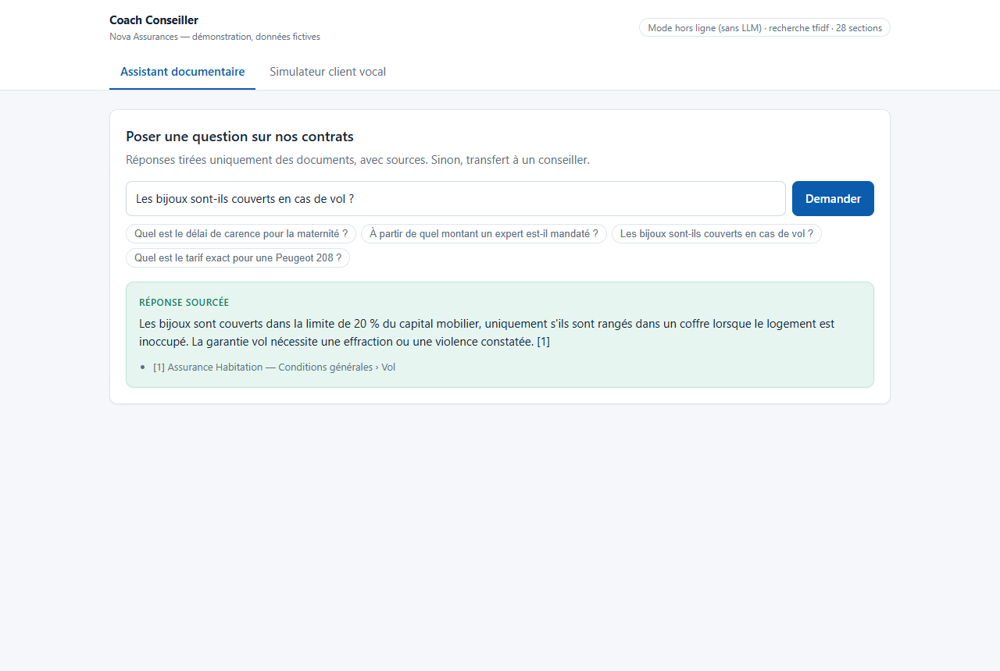
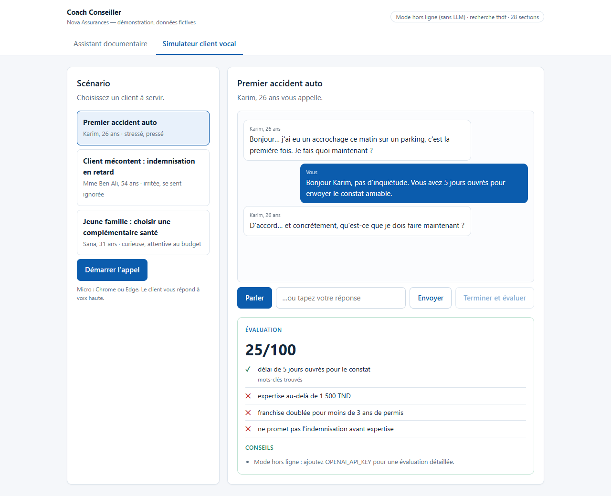

# Coach Conseiller: voice client simulator and document assistant for insurance advisors

Two tools for insurance advisors, built around one rule: **answer from the documents, with sources, or hand over to a human.**

1. **Assistant documentaire.** Advisors ask questions about the contracts and get a short answer **with citations**, or an explicit handoff when the documents don't contain the answer.
2. **Simulateur client vocal.** The advisor practises a phone call **by voice** with a simulated client (first car accident, an angry customer, a young family choosing health cover). At the end, the call is **scored** against the company's advice checklist, and the facts the advisor stated are checked against the documents.

**▶ [Demo video, about 2 min, French narration](https://github.com/MejriRami/advisor-voice-coach/releases/download/demo/1_Coach_Conseiller.mp4)** · fictional data

> **Résumé (FR)** : un assistant qui répond aux conseillers uniquement à partir des documents (avec sources, sinon transfert à un humain), et un simulateur de client à la voix pour entraîner les conseillers, avec une évaluation de l'appel. Toutes les données sont fictives (« Nova Assurances »).





---

## Guardrails, enforced in code

| Guardrail | Where |
|---|---|
| **Retrieval gate**: no answer is generated when the best passage scores below a threshold | `app/assistant.py` |
| **Grounding**: the model only sees the retrieved passages and must cite them as `[1]`, `[2]` | `SYSTEM_PROMPT` |
| **Citation check**: an answer without a valid citation is discarded and replaced by a handoff | `_cited_numbers` |
| **Explicit refusal**: the model answers `HANDOFF` when the passages are not enough | `SYSTEM_PROMPT` |
| **No prices, no promises**: never invent a premium; never promise an indemnity before the expert's assessment | prompt + debrief checklist |
| **Offline scope check**: keyword retrieval can't judge scope, so offline mode also requires most of the question's key words to be in the passage | `coverage()` |

## Measured, not assumed

`eval/questions.jsonl`: 24 in-scope questions with the facts the answer must contain and the document it must come from, plus 4 out-of-scope questions (exact price, an uncovered product, off-topic) where the right behaviour is a handoff.

```bash
python -m eval.run_eval
```

| Metric | **LLM mode** (OpenAI embeddings + gpt-4o-mini) | Offline mode (TF-IDF + extractive, no API key) |
|---|---|---|
| Retrieval hit@1 / hit@3 | 95.8 % / 100 % | 95.8 % / 100 % |
| Answer accuracy (all expected facts present) | **100 %** | 83.3 % |
| **Precision when answering** | **100 %** | 90.9 % |
| Answers with a citation | 100 % | 100 % |
| Out-of-scope questions handed to a human | **4 / 4** | 4 / 4 |
| In-scope questions wrongly handed off | **0 / 24** | 2 / 24 |

**Layered guardrails, measured.** In LLM mode the retrieval gate alone caught only 1 of the 4 out-of-scope questions (the off-topic one, score 0.28). The other three (an exact price, an uncovered product, an investment question) retrieved plausible passages (0.34–0.47) and were stopped by the **model's grounded refusal**. Neither layer is enough alone; together they reach 4/4 without a single wrong handoff. The lowest-scoring in-scope question still scored 0.54, so the gate (0.30) could be raised to about 0.50 for an extra margin.

What the measurement taught: with keyword retrieval alone, only **1 of 4** out-of-scope questions was handed off (*"conseiller un placement en bourse"* matched the advisor guide on the word *conseiller*). Adding the coverage check brought it to 4/4, and the two questions it now hands off were ones the system had been **answering wrongly**: fewer wrong answers, same accuracy. For an insurer, a handoff is better than a wrong answer, which is why *precision when answering* is the headline metric.

With `OPENAI_API_KEY` set, the same script measures the LLM mode (semantic retrieval + grounded generation); the tests keep the offline gate in CI.

## Architecture

```
 Browser ─ Web Speech API (speech-to-text, fr-FR) ─┐          ┌─ speechSynthesis (client voice)
                                                   ▼          │
                               FastAPI  /api/ask · /api/sim/{start,turn,debrief}
                                   │                     │
            ┌──────── Assistant ───┘                     └──── Simulator
            │  retrieve (OpenAI embeddings or TF-IDF)          persona role-play (LLM)
            │  gate → grounded answer → citation check         debrief: checklist + fact check
            ▼                                                  against the same knowledge base
     data/docs/*.md  (6 fictional contract documents, split by section)
```

- **Provider-agnostic**: the model is behind `app/llm.py` (`OPENAI_MODEL`), and embeddings are behind one interface. Swapping in a Mistral, Llama or self-hosted model is a single-file change.
- **Voice in the browser**: speech-to-text and speech-to-speech services (Whisper, Voxtral, Moshi) or a realtime framework (Pipecat, LiveKit) can replace the Web Speech API without changing the API.

## Run

```bash
python -m venv .venv && source .venv/bin/activate     # Windows: .venv\Scripts\activate
pip install -r requirements.txt
cp .env.example .env                                  # optional: OPENAI_API_KEY for LLM mode
uvicorn app.main:app --port 8090                      # open http://127.0.0.1:8090 (Chrome/Edge for the microphone)
pytest -q                                             # 11 offline tests
```

Without a key, the app runs fully offline: extractive answers, a scripted client and a checklist-based debrief.

## Layout

| Path | Content |
|---|---|
| `app/knowledge.py` | Document loading, section chunking, OpenAI / TF-IDF retrieval |
| `app/assistant.py` | Grounded answers, citations, handoff guardrails |
| `app/simulator.py` | Client personas, role-play, evaluated debrief |
| `app/static/index.html` | UI (no build step) |
| `eval/` | Question set and evaluation script |
| `data/docs/` | Fictional insurance documents |

---

*Personal project. All company names, documents and figures are fictional.*
